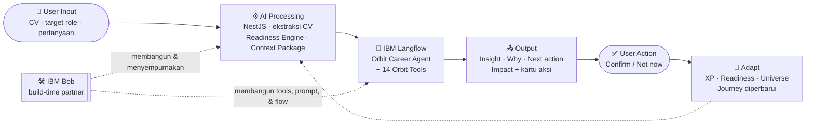
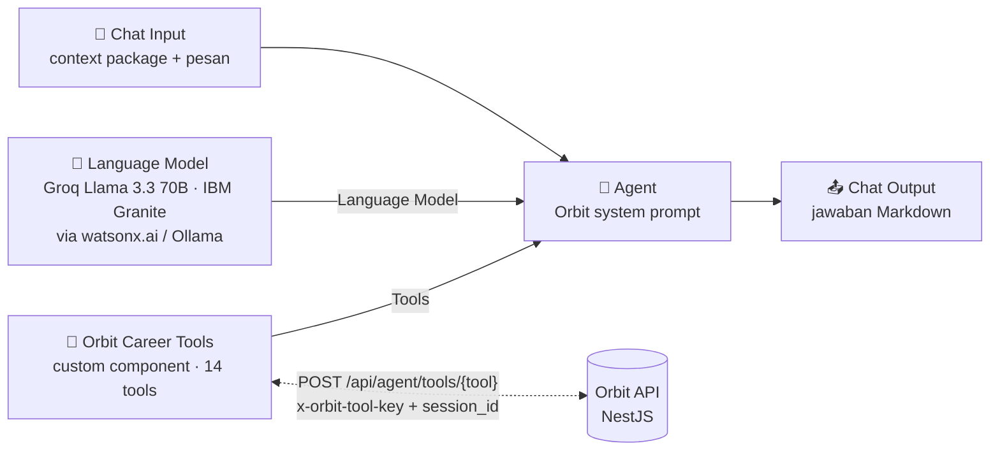
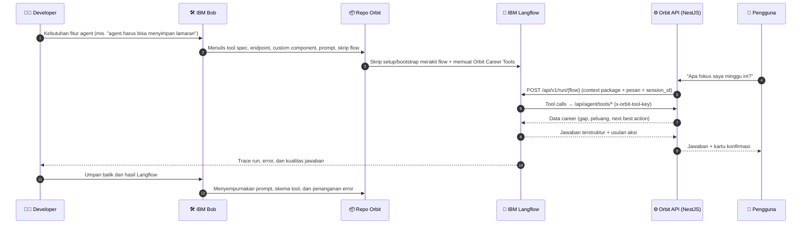
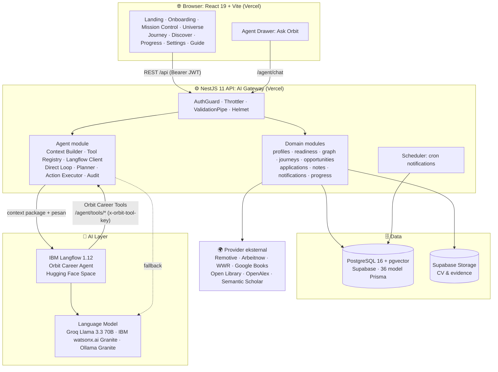
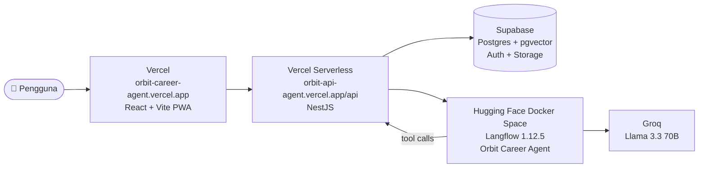

<div align="center">


# Orbit

### Build Your Path. Become Career-Ready.

**AI Career Navigator for Growth & Job Readiness**<br/>
Agentic Career & Personal Growth Platform yang memahami posisimu sekarang, menghubungkan semua hal yang bisa membantumu berkembang, lalu menunjukkan apa yang harus kamu lakukan berikutnya.

<br/>

[](https://orbit-career-agent.vercel.app)
[](https://hacktiv8.com/projects/ibm/hackathon)
[](#2-tema-project)

[](ai/langflow/README.md)
[](#10-penggunaan-ibm-bob)
[](#-menjalankan-secara-lokal)
[](#18-kemampuan-ai-agent)
[](#18-kemampuan-ai-agent)

[](https://react.dev)
[](https://vite.dev)
[](https://www.typescriptlang.org)
[](https://tailwindcss.com)
[](https://nestjs.com)
[](https://www.prisma.io)
[](https://github.com/pgvector/pgvector)
[](https://supabase.com)
[](https://huggingface.co/spaces/xStyNWx/orbit-langflow)
[](https://vercel.com)

[](#%EF%B8%8F-galeri-screenshot)
[](#-fitur-lengkap)
[](#-fitur-lengkap)

<br/>

**🇮🇩 Bahasa Indonesia** · [🇬🇧 English](README-eng.md)

<br/>

<picture>
  <source media="(prefers-color-scheme: dark)" srcset="assets/screenshots/dark/03-mission-control.png" />
  
</picture>

<sub>Mission Control Orbit. Gambar mengikuti tema GitHub kamu (terang/gelap).</sub>

</div>

---

> [!NOTE]
> **Satu pertanyaan, satu jawaban yang jelas.** Orbit selalu menjawab: *"Seberapa siap saya untuk karier impian saya, dan apa yang harus saya lakukan berikutnya?"* Semua fitur Orbit ada untuk menjawab pertanyaan itu.

## 📑 Daftar Isi

- [🧭 Ringkasan Singkat](#-ringkasan-singkat)
- [🔗 Akses Cepat](#-akses-cepat)
- [📋 Jawaban Submission Form](#-jawaban-submission-form)
  - [1. Judul Project](#1-judul-project) · [2. Tema](#2-tema-project) · [3. Deskripsi Singkat](#3-deskripsi-singkat-project) · [4. Problem Statement](#4-problem-statement) · [5. Target User](#5-target-user) · [6. Mengapa Dibutuhkan](#6-mengapa-solusi-ini-dibutuhkan)
  - [7. Fitur Utama](#7-fitur-utama-project) · [8. Alur Penggunaan](#8-alur-penggunaan-project) · [9. IBM Langflow](#9-penggunaan-ibm-langflow) · [10. IBM Bob](#10-penggunaan-ibm-bob) · [11. Integrasi Langflow & Bob](#11-bagaimana-ibm-langflow-dan-ibm-bob-terintegrasi)
  - [12. Project Link](#12-project-file--link) · [13. Pitching Deck](#13-pitching-deck) · [14. Screenshot](#14-project--prototype-screenshot) · [15. Dampak](#15-dampak-yang-dihasilkan) · [16. Skalabilitas](#16-potensi-pengembangan--skalabilitas) · [17. Pembeda](#17-apa-yang-membuat-project-ini-berbeda) · [18. Kemampuan AI Agent](#18-kemampuan-ai-agent)
- [✨ Fitur Lengkap](#-fitur-lengkap)
- [🖼️ Galeri Screenshot](#%EF%B8%8F-galeri-screenshot)
- [🏗️ Arsitektur Sistem](#%EF%B8%8F-arsitektur-sistem)
- [🧮 Engine Deterministik](#-engine-deterministik)
- [🛠️ Tech Stack](#%EF%B8%8F-tech-stack)
- [📁 Struktur Folder](#-struktur-folder)
- [🚀 Menjalankan Secara Lokal](#-menjalankan-secara-lokal)
- [☁️ Deployment](#%EF%B8%8F-deployment)
- [🧪 Testing & Kualitas](#-testing--kualitas)
- [🗺️ Roadmap](#%EF%B8%8F-roadmap)
- [👤 Tim](#-tim)

---

## 🧭 Ringkasan Singkat

Persiapan karier hari ini tersebar di banyak tempat: lowongan di job portal, course di platform belajar, paper di Google Scholar, catatan di Notion, dan saran di chatbot yang tidak mengenal penggunanya. Masalahnya bukan kurang informasi. **Masalahnya, tidak ada yang menghubungkan semua informasi itu dengan diri pengguna dan memberi tahu apa yang harus dilakukan lebih dulu.**

**Orbit** menyatukan CV, skill, pengalaman, tujuan, peluang, sumber belajar, dan role model ke dalam satu **Career Universe** yang hidup. Di atasnya bekerja **Orbit Career Agent**, AI Agent yang diorkestrasi dengan **IBM Langflow**. Agent ini membaca konteks pengguna, memakai 14 tools, dan mengusulkan aksi nyata yang baru dijalankan setelah pengguna menyetujuinya.

<div align="center">

| 🧠 5 | 🛠️ 14 | 📊 6 | 🎯 5 | 🗄️ 36 | 🌐 2 | 🌗 2 | 🛡️ 3 |
| :---: | :---: | :---: | :---: | :---: | :---: | :---: | :---: |
| sistem inti | tools AI Agent | kategori readiness | career path template | model data | bahasa (ID/EN) | tema (terang/gelap) | lapis fallback agent |

</div>

**Core loop Orbit:**

```text
Pahami saya → Petakan universe saya → Temukan peluang → Kenali gap → Bangun journey → Ambil aksi → Lacak progres → Beradaptasi ↺
```

**Prinsip desain:** *Bright, not noisy. Dynamic, not chaotic. Gamified, not childish. Intelligent, not complicated.*

---

## 🔗 Akses Cepat

| | Tautan | Keterangan |
| --- | --- | --- |
| 🌐 **Website (Live)** | **[orbit-career-agent.vercel.app](https://orbit-career-agent.vercel.app)** | Klik **"Explore the demo account"** di halaman Sign in. Tidak perlu daftar |
| 🔐 **Akun Demo** | `demo@orbit.app` / `OrbitDemo2026!` | Persona: **Stanley Wijaya**, mahasiswa Computer Science dengan target **Product Manager** |
| 🤖 **Langflow Engine** | [huggingface.co/spaces/xStyNWx/orbit-langflow](https://huggingface.co/spaces/xStyNWx/orbit-langflow) | Langflow 1.12 berjalan di Hugging Face Docker Space dan hanya dipanggil oleh API Orbit |
| ⚙️ **API Health** | [orbit-api-agent.vercel.app/api/health](https://orbit-api-agent.vercel.app/api/health) | Status database, auth, storage, model AI, dan Langflow |
| 💻 **Source Code** | [github.com/StyNW7/Orbit](https://github.com/StyNW7/Orbit) | Monorepo: web, API, flow Langflow, infra |
| 📄 **Sample CV** | [`docs/demo/sample-cv-stanley-wijaya.pdf`](docs/demo/sample-cv-stanley-wijaya.pdf) | Untuk mencoba onboarding dari awal (juga tersedia tombol "Use sample CV") |

---

## 📋 Jawaban Submission Form

> Bagian ini menjawab seluruh pertanyaan pada **National Hackathon — Project Submission Form** secara berurutan. Setiap jawaban sudah siap disalin ke formulir.

### 1. Judul Project

> **Orbit: AI Career Navigator for Growth & Job Readiness**

### 2. Tema Project

> **Education & Future of Work**

Orbit membantu mahasiswa dan talenta muda bertransisi dari dunia pendidikan ke dunia kerja. Orbit menerjemahkan target karier menjadi skill yang perlu dipelajari, pengalaman yang perlu dibangun, dan peluang yang perlu diambil.

### 3. Deskripsi Singkat Project

> Orbit adalah *Agentic Career & Personal Growth Platform* berbasis AI yang membantu mahasiswa dan fresh graduate memahami posisi karier mereka saat ini, menemukan gap, dan mengetahui langkah terbaik berikutnya untuk menjadi *career-ready*.
>
> Masalah utama yang ingin diselesaikan adalah persiapan karier yang terfragmentasi. Lowongan ada di job portal, course di platform belajar, paper di Google Scholar, catatan di Notion, dan saran di chatbot generik. Tidak ada satu pun yang memahami konteks pengguna, sehingga mahasiswa bingung harus mulai dari mana, skill apa yang kurang, dan peluang mana yang benar-benar relevan.
>
> Orbit bekerja dalam satu alur yang jelas. Pengguna mengunggah CV dan memilih target role. Orbit mengekstrak profil menjadi *Career DNA* dan menghitung *Career Readiness* secara deterministik dari enam kategori berbobot. Seluruh konteks dipetakan menjadi *Career Universe*, yaitu graph interaktif yang menghubungkan pengguna dengan skill, gap, pekerjaan, event, buku, paper, dan role model. Gap kemudian diubah menjadi *Adaptive Career Journey* berisi milestone, quest, task, dan XP. *Orbit Career Agent* yang diorkestrasi dengan IBM Langflow memakai 14 tools untuk membaca konteks, menganalisis gap, mencari peluang, dan mengusulkan aksi, dan selalu meminta konfirmasi pengguna sebelum mengubah data.
>
> Manfaat utamanya: arah karier yang personal dan dapat dijelaskan, rekomendasi yang selalu terhubung ke tujuan pengguna, progres yang terukur, serta satu jawaban konkret untuk pertanyaan terpenting, yaitu apa yang harus dilakukan berikutnya.

<sub>± 215 kata (dalam rentang 150–300 kata yang diminta).</sub>

### 4. Problem Statement

**Kondisi sebelum ada Orbit.** Seorang mahasiswa yang ingin menjadi Product Manager biasanya:

1. Membuka **LinkedIn / job portal** untuk mencari lowongan, lalu membandingkan sendiri kecocokannya.
2. Mencari **course** di YouTube atau platform belajar tanpa tahu skill mana yang paling mendesak.
3. Membaca **artikel atau paper** secara acak tanpa hubungan dengan targetnya.
4. Mencatat progres di **Notion atau spreadsheet** yang tidak memberi umpan balik.
5. Bertanya ke **chatbot AI generik** yang tidak tahu CV, pengalaman, atau lamaran yang sedang berjalan, sehingga jawabannya umum dan berulang.

**Pain point utama:**

| Pain point | Dampak bagi pengguna |
| --- | --- |
| 🧩 **Informasi terfragmentasi** di 5–8 platform berbeda | Waktu habis untuk mencari dan berpindah aplikasi, bukan untuk berkembang |
| ❓ **Tidak tahu posisi diri** ("Seberapa siap saya?") | Tidak ada ukuran kesiapan yang objektif dan bisa dijelaskan |
| 🎯 **Tidak tahu prioritas** ("Mulai dari mana?") | Belajar banyak hal acak, sementara gap terbesar tidak tersentuh |
| 🔗 **Rekomendasi tidak terhubung ke tujuan** | Lowongan, buku, dan event direkomendasikan karena populer, bukan karena relevan |
| 📉 **Progres tidak terukur** | Motivasi turun karena tidak ada bukti kemajuan |
| 🤖 **AI tanpa konteks & tanpa aksi** | Chatbot hanya memberi teks, tidak memahami riwayat dan tidak bisa bertindak |

**Mengapa penting.** Transisi dari kampus ke dunia kerja adalah salah satu fase paling menentukan bagi talenta muda Indonesia. Ketidakjelasan arah membuat banyak lulusan melamar ke posisi yang tidak sesuai, terlambat membangun portofolio, atau melewatkan peluang yang sebenarnya cocok. Membantu mereka mengambil **langkah yang tepat, pada waktu yang tepat, dengan alasan yang jelas** berdampak langsung pada kesiapan kerja dan kualitas talenta di masa depan.

### 5. Target User

| Segmen | Siapa | Kebutuhan utama |
| --- | --- | --- |
| 🎓 **Utama: Mahasiswa (D3–S2)** | Mahasiswa tingkat akhir dan menengah yang sedang menyiapkan internship atau pekerjaan pertama | Tahu gap skill, menemukan internship yang cocok, membangun portofolio |
| 🧑‍💼 **Fresh graduate & job seeker** | Lulusan 0–2 tahun yang mencari pekerjaan pertama atau kedua | Prioritas persiapan, pelacakan lamaran, latihan interview |
| 🔄 **Career switcher** | Profesional muda yang ingin pindah jalur (misalnya Software Engineer → Product Manager) | Membandingkan beberapa jalur karier dan memetakan *transferable skill* |
| 🏫 **Pemangku kepentingan (pengembangan)** | Career center kampus, bootcamp, dan program talenta | Memantau kesiapan kerja peserta secara agregat |

Persona demo: **Stanley Wijaya**, mahasiswa Computer Science yang menargetkan **Product Manager**. Ia punya latar teknis dan pengalaman kepemimpinan, tetapi masih memiliki gap di **Product Analytics**, **SQL**, dan **pengalaman produk profesional**.

### 6. Mengapa Solusi Ini Dibutuhkan?

| Cara saat ini | Dengan Orbit |
| --- | --- |
| Job portal mencocokkan **kata kunci** | **Hybrid matching** (role 25%, skill 25%, pengalaman 20%, preferensi 15%, tujuan 15%) lengkap dengan alasan "kenapa cocok", skill yang kurang, dan aksi berikutnya |
| Chatbot AI **tidak punya memori jangka panjang** | Agent menerima **context package** dari database (target, readiness, gap, quest, lamaran, insight) setiap kali menjawab |
| Chatbot hanya **memberi teks** | Agent **bertindak**: menambah quest, menyimpan lamaran, membuat reminder, memperbarui graph, semuanya dengan konfirmasi |
| Skor kesiapan "dari AI" yang **berubah-ubah** | **Career Readiness deterministik** dari 6 kategori berbobot. AI hanya menjelaskan, tidak mengarang angka |
| Rekomendasi **acak/populer** | Setiap rekomendasi **wajib terhubung** ke tujuan, gap, journey, peluang aktif, atau konteks pribadi pengguna |
| Progres di checklist **tanpa makna** | Quest berbasis **evidence**: XP, readiness, dan Career Universe ikut berubah saat task selesai |
| Banyak aplikasi terpisah | **Satu platform** dengan 5 navigasi utama dan agent yang tersedia di semua halaman |

Singkatnya, Orbit tidak menggantikan LinkedIn, Coursera, atau Google Scholar. **Orbit adalah *intelligence layer* di atas semuanya**: memahami, menghubungkan, memprioritaskan, membimbing, melacak, lalu beradaptasi.

### 7. Fitur Utama Project

1. **🧬 Career Intelligence (CV → Career DNA → Readiness).** Mengekstrak CV (PDF atau teks) menjadi profil terstruktur: skill, pengalaman, pendidikan, dan pencapaian. Hasilnya adalah **Career DNA** (kekuatan & gap) dan **Career Readiness Score** yang deterministik dan dapat dijelaskan.
2. **🌌 Career Universe (Knowledge Graph Interaktif).** Graph orbital (Sigma.js + Graphology) yang menghubungkan pengguna dengan role, skill, gap, pengalaman, lowongan, event, buku, paper, dan role model. Setiap node bisa diklik untuk melihat "kenapa ini penting", lalu **Add to Journey**.
3. **🔭 Opportunity Intelligence (Discover).** Empat tab: **Jobs, Growth, Knowledge, People**. Lowongan diberi skor match dan penjelasan. Event, buku (Google Books, Open Library), paper (OpenAlex, Semantic Scholar), dan role model direkomendasikan berdasarkan gap terbesar. Tersedia pelacakan lamaran dari *save* sampai *offer*.
4. **🗺️ Adaptive Career Journey (Gamified Roadmap).** Gap diubah menjadi **milestone → quest → task → evidence** dengan XP, level, streak, deadline, beberapa *career orbit* sekaligus, dan **Career Journal** yang mendeteksi pola kesulitan dari catatan pengguna.
5. **🤖 Orbit Career Agent (IBM Langflow + 14 Tools + Human-in-the-Loop).** Satu orchestrator agent di Langflow yang membaca konteks, memilih tools, menjawab dengan struktur *Insight · Why it matters · Next best action · Expected impact*, dan mengusulkan **kartu aksi** yang baru dijalankan setelah pengguna menyetujuinya.

### 8. Alur Penggunaan Project

```text
User Input → AI Processing (NestJS) → Langflow (Orbit Career Agent) → Output → User Action → Sistem Beradaptasi ↺
                    ▲                              ▲
                    └──────── dibangun & disempurnakan bersama IBM Bob ────────┘
```

| # | Tahap | Yang terjadi |
| :---: | --- | --- |
| 1 | **User Input** | Pengguna mendaftar, memilih target role, mengunggah CV, mengisi minat, preferensi, dan konteks pribadi (6 langkah onboarding) |
| 2 | **AI Processing** | NestJS mengekstrak teks CV, AI menyusun profil terstruktur (divalidasi Zod), engine deterministik menghitung **Career Readiness**, lalu graph **Career Universe** dibangun |
| 3 | **Career Intelligence** | Pengguna melihat Career DNA: kekuatan, gap utama, skor readiness, dan *next best action* |
| 4 | **Explore & Plan** | Pengguna menjelajahi Universe, membuka node gap (misalnya *Product Analytics*), lalu menekan **Add to Journey**. Journey dan quest terbentuk otomatis |
| 5 | **Discover** | Orbit menampilkan internship, event, buku, paper, dan role model untuk gap terbesar. Pengguna **Save & track** lowongan, lalu Orbit mendeteksi deadline dan menjadwalkan reminder |
| 6 | **Ask Orbit → Langflow** | Pengguna bertanya, misalnya *"Apa fokus saya minggu ini?"*. NestJS menyusun **context package**, lalu mengirimkannya ke flow **Orbit Career Agent** di Langflow. Agent memanggil tools seperti `get_user_context` dan `get_next_best_action` |
| 7 | **Output** | Jawaban Markdown terstruktur, chip tool yang dipakai, dan **kartu aksi** (misalnya "Tambahkan *Master Product Metrics* ke Journey") |
| 8 | **User Action** | Pengguna **Confirm** atau **Not now**. Jika dikonfirmasi, aksi dieksekusi dan dicatat di audit log |
| 9 | **Adapt** | Task selesai → XP bertambah → readiness dihitung ulang → Universe dan rekomendasi diperbarui → siklus berulang |



### 9. Penggunaan IBM Langflow

IBM Langflow adalah **lapisan orkestrasi AI Agent** di Orbit. Seluruh penalaran agent, pemilihan tool, dan pemanggilan tool terjadi di dalam flow Langflow bernama **Orbit Career Agent**.

#### a. Workflow / flow yang dibuat



File flow tersedia di [`ai/langflow/flows/orbit-agent.json`](ai/langflow/flows/orbit-agent.json) dan dapat diimpor melalui UI Langflow. Flow juga dibangun **otomatis** oleh skrip [`infra/scripts/langflow-setup.mjs`](infra/scripts/langflow-setup.mjs) (lokal) dan [`hugging-face/orbit/bootstrap.py`](hugging-face/orbit/bootstrap.py) (production). Kedua skrip mengambil template komponen langsung dari Langflow yang sedang berjalan (`GET /api/v1/all`), sehingga flow selalu cocok dengan versi Langflow yang terpasang.

#### b. Node / component yang digunakan

| Component | Fungsi dalam flow |
| --- | --- |
| **Chat Input** | Menerima pesan dari API Orbit. Isinya `[ORBIT CONTEXT]` package ditambah pertanyaan pengguna |
| **Agent** | Inti penalaran. Berisi **Orbit system prompt** ([`orbit-system-prompt.md`](ai/langflow/prompts/orbit-system-prompt.md)) yang mewajibkan setiap rekomendasi terhubung ke tujuan atau gap pengguna, melarang mengarang data, dan meminta konfirmasi sebelum ada perubahan |
| **Language Model** | Model yang dapat diganti lewat satu variabel `LANGFLOW_MODEL_PROVIDER`: **IBM Granite** di **IBM watsonx.ai**, **Ollama** (Granite 3.3 lokal), atau **Groq** (Llama 3.3 70B, dipakai di production karena cepat) |
| **Orbit Career Tools** *(custom component)* | Komponen Python buatan sendiri ([`orbit_career_tools.py`](ai/langflow/custom-components/orbit/orbit_career_tools.py)). Komponen ini membaca `GET /api/agent/tools/manifest` lalu mengekspos **14 tools** sebagai LangChain `StructuredTool` |
| **Chat Output** | Mengembalikan jawaban akhir agent ke API Orbit |

#### c. Input & output

| | Isi |
| --- | --- |
| **Input** | `input_value` = `[ORBIT CONTEXT]` (target role, readiness, top gaps, quest aktif, lamaran, insight terbaru, konteks halaman, bahasa) + pesan pengguna. `session_id` = ID percakapan Orbit (memori jangka pendek dan identitas untuk tool call) |
| **Output** | Jawaban Markdown terstruktur (*Insight · Why it matters · Next best action · Expected impact*), daftar tool yang dipanggil, dan **AgentAction** (kartu konfirmasi) yang dibuat oleh tools bertipe SUGGEST/WRITE |

#### d. Proses AI Agent

```text
OBSERVE → UNDERSTAND → RETRIEVE CONTEXT → DECIDE → SELECT TOOL → ACT → (USER CONFIRMS) → UPDATE SYSTEM → EVALUATE → RECOMMEND NEXT ACTION
```

1. **Observe & understand.** Agent membaca context package dan pertanyaan pengguna.
2. **Decide & select tool.** Agent memilih tool yang dibutuhkan, misalnya `analyze_career_gap` → `find_opportunities` → `search_books`.
3. **Act.** Orbit Career Tools memanggil API Orbit. Tools **READ** langsung mengembalikan data. Tools **SUGGEST/WRITE** hanya *mengusulkan* `AgentAction`.
4. **Respond.** Agent menyusun jawaban yang menjelaskan alasan dan dampak.
5. **Human-in-the-loop.** Pengguna mengonfirmasi kartu aksi di UI, lalu `ActionExecutor` menjalankan perubahan. Graph, readiness, dan progres ikut diperbarui, dan semua tercatat di audit log.

#### e. Fungsi Langflow dalam keseluruhan sistem

- **Otak orkestrasi.** Langflow menentukan *kapan* dan *tool apa* yang dipakai. Logika bisnis tetap aman di API.
- **Model-agnostic.** Model bisa berganti antara IBM watsonx.ai, Ollama, atau Groq tanpa mengubah kode aplikasi.
- **Aman.** Browser tidak pernah berbicara langsung dengan Langflow. NestJS menjadi *AI gateway*. Tool call memakai *shared secret* terpisah (`x-orbit-tool-key`, dibandingkan secara timing-safe) dan tidak pernah membawa token pengguna. API key model disimpan sebagai *credential variable* Langflow, bukan di dalam JSON flow.
- **Andal.** Langflow adalah engine utama, tetapi bukan *single point of failure*. Rantai fallback-nya: **Langflow → direct model tool loop → deterministic planner**. Setelah Langflow gagal atau timeout, Orbit melewatinya selama 5 menit agar pengguna tidak menunggu.

### 10. Penggunaan IBM Bob

**IBM Bob** adalah *AI software development partner* yang kami gunakan sepanjang siklus pembuatan Orbit, dari ide sampai deployment. Jika Langflow adalah otak Orbit **saat berjalan** (*runtime*), maka IBM Bob adalah rekan engineer **saat membangun** (*build-time*).

| Fase | Task yang dikerjakan bersama IBM Bob | Output yang dihasilkan |
| --- | --- | --- |
| 💡 **Ideation & product scoping** | Menyusun dan menajamkan ide Orbit, mengunci scope menjadi **5 core systems**, menyusun *golden demo flow*, dan merumuskan prinsip desain | Dokumen konteks produk, scope boundary, dan alur demo |
| 🏛️ **Arsitektur** | Merancang monorepo pnpm (web, API, shared, langflow, infra), domain modules NestJS, skema Prisma (36 model), dan arsitektur *AI gateway* | Struktur repo, `schema.prisma`, dan diagram arsitektur |
| 🎨 **Vibe coding frontend** | Membangun halaman React (Landing, Onboarding, Mission Control, Universe, Journey, Discover, Progress, Settings, Guide), tema terang/gelap, dan i18n ID/EN | Komponen UI di `apps/web/src/features/*` |
| ⚙️ **Vibe coding backend** | Membuat Readiness Engine, Job Match Engine, Journey Planner, Graph Builder, notifikasi terjadwal, dan auth guard | Modul di `apps/api/src/modules/*` |
| 🤖 **Membangun bagian AI Agent** | Merancang 14 tool spec dan level READ/SUGGEST/WRITE, menulis **custom component Langflow** (Python), system prompt, Langflow client dan fallback chain, serta skrip pembangun flow | `tool-registry.service.ts`, `orbit_career_tools.py`, `orbit-system-prompt.md`, `langflow-setup.mjs`, `bootstrap.py` |
| 🧪 **Testing & debugging** | Menulis unit test Jest, menganalisis error dan log Langflow, serta memperbaiki bug integrasi | 9 file test (readiness, job matching, journey planner, graph builder, agent confirmation, auth guard, DTO, job providers, locale) |
| 🚀 **Deployment & dokumentasi** | Menyiapkan Dockerfile Hugging Face Space, konfigurasi Vercel, panduan deployment, dan dokumentasi | `hugging-face/Dockerfile`, `vercel.json`, README |

**Bagaimana Bob berinteraksi dengan sistem.** Bob bekerja langsung di dalam **workspace dan repository Orbit**. Bob membaca codebase, memahami konteks file yang ada, mengusulkan dan menerapkan perubahan kode, menjalankan perintah (build, test, lint), dan membantu men-debug hasil eksekusi. Setiap perubahan dari Bob direview developer sebelum di-commit. Jadi Bob tidak berjalan di production; **hasil kerjanya adalah sistem Orbit itu sendiri**.

### 11. Bagaimana IBM Langflow dan IBM Bob Terintegrasi?

Keduanya membentuk satu siklus: **IBM Bob membangun dan menyempurnakan apa yang dijalankan Langflow, lalu hasil eksekusi Langflow menjadi masukan bagi Bob untuk iterasi berikutnya.**

**1. Apa yang dilakukan Langflow?**
Langflow menjalankan **Orbit Career Agent** saat runtime. Ia menerima context package dan pesan pengguna, bernalar dengan language model, memanggil 14 Orbit tools, lalu menghasilkan jawaban serta usulan aksi.

**2. Apa yang dilakukan Bob?**
Bob membangun semua "jembatan" yang membuat agent di Langflow bisa bekerja dengan data nyata Orbit:
- **Custom component** `Orbit Career Tools` (Python) yang dimuat Langflow sebagai tool provider.
- **Tool API** di NestJS (`/api/agent/tools/manifest` dan `/api/agent/tools/{tool}`) beserta skema parameter dan level keamanannya.
- **System prompt** agent yang ditempel ke komponen Agent.
- **Skrip pembangun flow** (`langflow-setup.mjs`, `bootstrap.py`) yang merakit *Chat Input → Agent → Chat Output* + model + tools melalui Langflow API, lalu mengekspor `orbit-agent.json`.
- **LangflowClient** di NestJS, context builder, dan rantai fallback.

**3. Bagaimana data/informasi berpindah di antara keduanya?**



- **Bob → Langflow (build-time):** kode komponen, prompt, definisi flow, dan skema tool mengalir dari repository yang dibangun bersama Bob ke dalam Langflow, baik melalui skrip setup maupun Docker image Hugging Face Space.
- **Langflow → API → Langflow (runtime):** saat pengguna bertanya, Langflow memanggil endpoint tool yang dibangun bersama Bob. Data career mengalir kembali ke agent.
- **Langflow → Bob (iterasi):** trace eksekusi, error, dan kualitas jawaban dari Langflow dibawa kembali ke Bob untuk memperbaiki prompt, skema tool, dan logika fallback.

**4. Apa output akhir dari integrasi tersebut?**
Sebuah **AI Career Agent yang berfungsi penuh dan dapat bertindak**. Agent ini menjawab berdasarkan data nyata pengguna dengan format *Insight · Why it matters · Next best action · Expected impact*, menampilkan tool yang dipakai, dan mengusulkan **aksi yang dapat dikonfirmasi** (menambah quest, menyimpan lamaran, membuat reminder, memperbarui graph). Hasil akhirnya adalah pengguna yang tahu persis langkah berikutnya, dan setiap langkah itu langsung memperbarui Journey, Readiness, dan Career Universe mereka.

### 12. Project File / Link

| Jenis | Link |
| --- | --- |
| 🌐 Website live | https://orbit-career-agent.vercel.app |
| 💻 Repository GitHub | https://github.com/StyNW7/Orbit |
| 🤖 Langflow Space | https://huggingface.co/spaces/xStyNWx/orbit-langflow |
| 📘 Dokumentasi | README ini, [`docs/architecture/README.md`](docs/architecture/README.md), [`ai/langflow/README.md`](ai/langflow/README.md) |

### 13. Pitching Deck

Pitching deck (project, problem, solution, AI Agent, dan impact) diunggah langsung pada formulir submission dalam format PDF. Ringkasan isinya ada di README ini: [Problem](#4-problem-statement) → [Solusi & Fitur](#7-fitur-utama-project) → [AI Agent](#18-kemampuan-ai-agent) → [Dampak](#15-dampak-yang-dihasilkan).

### 14. Project / Prototype Screenshot

Screenshot website lengkap dalam mode terang dan gelap tersedia di [Galeri Screenshot](#%EF%B8%8F-galeri-screenshot) dan folder [`assets/screenshots/`](assets/screenshots). Rekomendasi pemetaan ke formulir:

| File formulir | Screenshot |
| --- | --- |
| `01-user-interface.png` | [`03-mission-control.png`](assets/screenshots/light/03-mission-control.png) |
| `02-langflow-workflow.png` | Tangkapan kanvas flow **Orbit Career Agent** di Langflow (lihat [diagram flow](#a-workflow--flow-yang-dibuat)) |
| `03-bob-integration.png` | Tangkapan sesi IBM Bob saat membangun tool/komponen agent |
| `04-output.png` | [`11-agent.png`](assets/screenshots/light/11-agent.png) (jawaban agent + kartu aksi) dan [`04-universe.png`](assets/screenshots/light/04-universe.png) |

### 15. Dampak yang Dihasilkan

| Indikator | Sebelum Orbit | Dengan Orbit (target / estimasi) |
| --- | --- | --- |
| ⏱️ Waktu riset karier mingguan | ± 3–5 jam berpindah di 5–8 platform | **± 30 menit** di satu dasbor (Mission Control + Discover) |
| 🧭 Waktu untuk tahu "harus mulai dari mana" | Berhari-hari, bergantung pada mentor | **< 5 menit**: onboarding 6 langkah → Career DNA + next best action |
| 💬 Waktu mendapat saran personal | Menunggu jadwal konsultasi career center | **Hitungan detik** lewat Orbit Agent, tersedia 24/7 di setiap halaman |
| 🎯 Relevansi rekomendasi | Populer/acak, tanpa alasan | **100% rekomendasi disertai alasan** dan terhubung ke gap/tujuan |
| 📊 Ukuran kesiapan | Tidak ada / subjektif | **Skor readiness 0–100** dari 6 kategori, dengan riwayat dan tren |
| 📅 Deadline lamaran terlewat | Sering, dicatat manual | **Deteksi deadline + reminder otomatis** saat lowongan disimpan |
| 📈 Skala | 1 konselor : ratusan mahasiswa | **1 agent : tak terbatas** pengguna. Target awal **1.000 pengguna/bulan** melalui kampus pilot |

**Dampak kualitatif:** mahasiswa membangun skill yang benar-benar dibutuhkan role targetnya, melamar ke posisi yang lebih cocok, dan tetap termotivasi karena progresnya terlihat (XP, level, streak, timeline). Untuk career center kampus, Orbit mengurangi pekerjaan manual konsultasi dasar yang berulang.

### 16. Potensi Pengembangan & Skalabilitas

| Arah | Rencana |
| --- | --- |
| 🏫 **B2B2C: kampus & career center** | Dasbor kohort untuk memantau kesiapan kerja mahasiswa, pemetaan gap kurikulum, dan integrasi dengan program magang kampus |
| 🏢 **Perusahaan & rekruter** | Talent pool berbasis readiness yang terverifikasi evidence, dan *early talent pipeline* untuk program internship |
| 🎓 **Bootcamp, platform kursus, IBM SkillsBuild** | Provider course dan sertifikasi langsung masuk ke Discover dan Journey, termasuk rekomendasi modul IBM SkillsBuild untuk gap tertentu |
| 🏛️ **Pemerintah & program talenta digital** | Agregasi gap skill nasional per wilayah dan per role untuk perencanaan program pelatihan |
| 🧩 **Lebih banyak role & industri** | Role template saat ini (5) dapat diperluas lewat katalog data tanpa mengubah engine |
| ⚙️ **Skalabilitas teknis** | Provider architecture (job/book/paper/event), engine deterministik yang murah dijalankan, pgvector untuk pencarian semantik, model agent yang bisa diganti (watsonx.ai, Groq, Ollama), deployment serverless (Vercel), dan jalur upgrade ke BullMQ/Redis, web push, serta integrasi **watsonx Orchestrate** |

### 17. Apa yang Membuat Project Ini Berbeda?

1. **🌌 Career Universe, bukan daftar.** Orbit memodelkan karier sebagai **knowledge graph pribadi** yang menghubungkan pengguna, role, skill, gap, peluang, pengetahuan, dan orang. Graph ini actionable: setiap node bisa langsung menjadi quest di Journey, dan graph ikut berubah saat pengguna berkembang.
2. **⚖️ Hybrid intelligence yang dapat dijelaskan.** Angka penting (readiness, match score) dihitung **secara deterministik** dengan bobot transparan. LLM hanya **menjelaskan dan bernalar**, tidak pernah mengarang skor, data lowongan, atau deadline. Hasilnya konsisten, dapat diaudit, dan dapat dipercaya.
3. **🤖 Agent yang bertindak dengan izin.** Orbit Agent bukan chatbot. Ia memiliki memori jangka panjang (context package dari database), **14 tools**, kesadaran konteks halaman, dan alur **human-in-the-loop**: membaca otomatis, mengusulkan aksi, lalu mengeksekusi setelah dikonfirmasi, dengan audit log lengkap. Agent juga tetap menjawab saat model lambat berkat rantai fallback 3 lapis.

### 18. Kemampuan AI Agent

Orbit Career Agent adalah **satu orchestrator agent** di IBM Langflow dengan **14 tools** yang terbagi menjadi tiga level keamanan:

| Level | Perilaku | Tools |
| --- | --- | --- |
| 🟢 **READ** (otomatis) | Dijalankan langsung untuk mengambil data | `get_user_context`, `analyze_career_profile`, `analyze_career_gap`, `find_opportunities`, `search_growth_resources`, `search_books`, `search_papers`, `find_role_models`, `get_next_best_action` |
| 🟡 **SUGGEST** (semi-otomatis) | Membuat kartu saran yang bisa diterima atau diabaikan | `update_career_graph`, `create_reminder` |
| 🟠 **WRITE** (semi-otomatis, wajib konfirmasi) | Mengusulkan perubahan, yang baru dieksekusi setelah pengguna menekan **Confirm** | `build_career_journey`, `update_progress`, `manage_application` |

**Tugas otomatis:**
- 📥 Membaca dan merangkum konteks karier pengguna (target, readiness, gap, quest, lamaran, insight).
- 🔍 Menganalisis gap skill terhadap role target (level saat ini vs level yang dibutuhkan).
- 💼 Mencari dan memeringkat lowongan dengan skor match serta penjelasannya.
- 📚 Menemukan course, event, buku, paper, dan role model untuk gap tertentu.
- 🧭 Menentukan *next best action* beserta alasan dan dampaknya.
- 📝 Mendeteksi pola dari Career Journal (misalnya "Product Metrics disebut sebagai kesulitan 3 kali").
- 🔔 Membuat notifikasi terjadwal untuk deadline, event, follow-up, dan weekly review (scheduler di backend).

**Tugas semi-otomatis (dengan konfirmasi):**
- ➕ Membuat atau memperluas Career Journey (milestone dan quest) dari gap.
- ✅ Menandai task quest sebagai selesai saat pengguna bilang sudah mengerjakannya.
- 💾 Menyimpan lowongan sebagai lamaran atau mengubah status lamaran.
- ⏰ Membuat reminder dari bahasa alami ("besok 19:00", "in 2 days", "next monday").
- 🌌 Menambah node baru ke Career Universe.

**Contoh interaksi:**

```text
👤  "Saya ingin jadi Product Manager. Apa yang harus saya fokuskan minggu ini?"

🤖  get_user_context → analyze_career_gap → get_next_best_action

    INSIGHT           Fokus minggu ini: Gain Practical Product Experience.
    WHY IT MATTERS    Product Analytics adalah gap terbesarmu. Lamaran APM di Kopiloka
                      berdeadline 13 hari lagi. Interview Readiness adalah kategori terendah (65).
    NEXT BEST ACTION  Tailor your CV for product roles.
    EXPECTED IMPACT   +5 Stakeholder Management dan progres quest aktif.

    [ Open quest ]  [ Add "Master Product Metrics" to Journey ]  [ Not now ]
```

Agent juga **context-aware per halaman** (Universe, Journey, Discover, dan lain-lain), menjawab dalam **bahasa pilihan pengguna** (ID/EN), dan menyimpan setiap aksinya di **audit log** pada menu Settings.

---

## ✨ Fitur Lengkap

<table>
<tr>
<td width="50%" valign="top">

### 🧬 Career Intelligence
- Onboarding 6 langkah: target role → CV → minat → preferensi → konteks → analisis
- Upload CV PDF (validasi *magic-byte* dan batas ukuran) atau tempel teks
- Ekstraksi terstruktur oleh AI dengan parser heuristik sebagai cadangan, divalidasi Zod
- **Career DNA**: kekuatan, gap, dan rangkuman profil
- **Career Readiness Engine** deterministik dengan snapshot historis

</td>
<td width="50%" valign="top">

### 🌌 Career Universe
- Graph orbital Sigma.js + Graphology (72+ node pada akun demo)
- Pencarian, 6 filter (Career, Skills, Experience, Opportunity, Knowledge, People)
- Zoom, pan, drag, dan fokus node
- Drawer detail node: status, level, alasan pentingnya, sumber terkait
- Tombol **Add to Journey** langsung dari node

</td>
</tr>
<tr>
<td valign="top">

### 🔭 Opportunity Intelligence
- **Top picks** untuk gap terbesar: internship, event, buku, paper, role model
- **Jobs** dengan hybrid match score, "why you match", skill yang kurang, dan next action
- Provider: data kurasi, Remotive, Arbeitnow, We Work Remotely (RSS), Google Books, Open Library, OpenAlex, Semantic Scholar
- **Applications**: save → prepare → apply → interview → offer, deteksi deadline, latihan interview

</td>
<td valign="top">

### 🗺️ Adaptive Career Journey
- Roadmap serpentine (@xyflow/react): milestone → quest → task → evidence
- XP, level, streak, deadline, dan *Generate full roadmap*
- **My Orbits**: beberapa jalur karier sekaligus, dengan satu yang utama
- **Career Journal** dengan *pattern insight*
- Progres langsung memengaruhi readiness dan Universe

</td>
</tr>
<tr>
<td valign="top">

### 🤖 Orbit Career Agent
- Drawer "Ask Orbit" tersedia di semua halaman
- Jawaban Markdown terstruktur, chip tool, dan kartu konfirmasi
- Riwayat percakapan dan audit log aksi
- Status engine aktif (Langflow / Direct model / Orbit planner)
- Mengikuti bahasa pengguna (header `X-Orbit-Locale`)

</td>
<td valign="top">

### 📈 Progress & Gamification
- Riwayat readiness (grafik area) dan radar per kategori
- Statistik skill, quest, lamaran, interview, dan offer
- **Orbit Timeline** pencapaian
- XP dari progres nyata: task +10, skill quest +100, project +300, sertifikasi +250, offer internship +500

</td>
</tr>
<tr>
<td valign="top">

### 🔔 Notifikasi & Reminder
- Scheduler `@nestjs/schedule` untuk deadline, event, follow-up, dan weekly review
- Notification center di aplikasi
- Reminder terhubung ke graph (gap → event → reminder), bukan spam acak

</td>
<td valign="top">

### 🎨 UX & Aksesibilitas
- **Mode terang dan gelap** dengan animasi *circular reveal* (View Transitions), plus opsi System
- **Bahasa Indonesia dan English** di semua halaman, dengan kamus yang dicek tipe saat build
- Command palette (`Ctrl + K`), halaman **Guide**, checklist *Getting started*, dan FAQ
- PWA installable dan responsif

</td>
</tr>
</table>

---

## 🖼️ Galeri Screenshot

> Semua screenshot diambil langsung dari website live **[orbit-career-agent.vercel.app](https://orbit-career-agent.vercel.app)** menggunakan akun demo, dalam tampilan desktop 1440×900.

<table>
<tr>
<th width="50%">☀️ Light Mode</th>
<th width="50%">🌙 Dark Mode</th>
</tr>

<tr><td colspan="2" align="center"><b>Landing Page</b>: <i>"Your career is not a straight line."</i></td></tr>
<tr>
<td></td>
<td></td>
</tr>

<tr><td colspan="2" align="center"><b>Sign In</b>: masuk dengan email atau langsung coba akun demo</td></tr>
<tr>
<td></td>
<td></td>
</tr>

<tr><td colspan="2" align="center"><b>Mission Control</b>: readiness, quest aktif, next best action, dan Orbit Insight</td></tr>
<tr>
<td></td>
<td></td>
</tr>

<tr><td colspan="2" align="center"><b>Career Universe</b>: knowledge graph karier yang interaktif</td></tr>
<tr>
<td></td>
<td></td>
</tr>

<tr><td colspan="2" align="center"><b>Adaptive Career Journey</b>: roadmap milestone dan quest</td></tr>
<tr>
<td></td>
<td></td>
</tr>

<tr><td colspan="2" align="center"><b>Discover</b>: top picks untuk gap terbesar dan lowongan dengan match score</td></tr>
<tr>
<td></td>
<td></td>
</tr>

<tr><td colspan="2" align="center"><b>Progress</b>: riwayat readiness dan radar kategori</td></tr>
<tr>
<td></td>
<td></td>
</tr>

<tr><td colspan="2" align="center"><b>Orbit Career Agent</b>: jawaban terstruktur, tool calls, dan kartu aksi</td></tr>
<tr>
<td></td>
<td></td>
</tr>

<tr><td colspan="2" align="center"><b>Profile</b>: Career DNA, skill, pengalaman, dan pendidikan</td></tr>
<tr>
<td></td>
<td></td>
</tr>

<tr><td colspan="2" align="center"><b>Settings</b>: tema, bahasa, status Orbit Career Agent, dan audit log</td></tr>
<tr>
<td></td>
<td></td>
</tr>

<tr><td colspan="2" align="center"><b>Guide</b>: panduan setiap area untuk pengguna baru</td></tr>
<tr>
<td></td>
<td></td>
</tr>
</table>

---

## 🏗️ Arsitektur Sistem



**Keputusan arsitektur penting:**

- 🔒 **Browser tidak pernah memanggil Langflow atau model secara langsung.** NestJS menjadi *AI gateway* untuk keamanan, injeksi konteks, validasi, logging, rate limiting, dan kontrol akses tool.
- 🧠 **Dua jenis memori.** Memori jangka pendek ada di sesi Langflow (`session_id` = ID percakapan). Memori jangka panjang ada di PostgreSQL (profil, skill, journey, quest, catatan, lamaran, insight), bukan di riwayat chat.
- 🛡️ **Rantai fallback agent:** `Langflow → direct model tool loop → deterministic planner`. Agent **selalu menjawab**, dan Orbit melewati Langflow secara otomatis jika modelnya terukur terlalu lambat atau baru saja gagal.
- 🧾 **Human-in-the-loop dan audit.** Tools READ berjalan otomatis. SUGGEST/WRITE membuat `AgentAction` yang harus dikonfirmasi, dan setiap aksi tercatat.
- 🔐 **Keamanan.** JWT diverifikasi di setiap rute privat dan semua query difilter berdasarkan user ID. Tersedia DTO whitelist, Zod untuk output AI, validasi upload berbasis magic bytes, Helmet, CORS terbatas, rate limit yang lebih ketat di `/agent/chat`, dan *error envelope* tanpa stack trace. Secret hanya ada di server; browser hanya melihat nilai `VITE_*`.

Detail lebih lanjut ada di [`docs/architecture/README.md`](docs/architecture/README.md) dan [`ai/langflow/README.md`](ai/langflow/README.md).

---

## 🧮 Engine Deterministik

> **"AI menjelaskan, engine menghitung."** Angka yang menentukan keputusan pengguna tidak boleh berubah-ubah. Karena itu Orbit menghitungnya secara deterministik.

<table>
<tr>
<td width="50%" valign="top">

**Career Readiness Score** (dapat dikonfigurasi lewat `READINESS_WEIGHTS`)

| Kategori | Bobot |
| --- | ---: |
| Skill Match | **30%** |
| Experience Match | **25%** |
| Portfolio | **15%** |
| Knowledge | **10%** |
| Application Readiness | **10%** |
| Interview Readiness | **10%** |

</td>
<td width="50%" valign="top">

**Hybrid Job Matching**

| Komponen | Bobot |
| --- | ---: |
| Role Alignment | **25%** |
| Skill Match | **25%** |
| Experience Match | **20%** |
| Preference Match | **15%** |
| Career Goal Match | **15%** |

</td>
</tr>
</table>

Pipeline rekomendasi: **structured filtering → vector similarity (pgvector, embedding 768 dimensi) → deterministic ranking → LLM reasoning**. Setiap match mengembalikan skor per komponen, skill yang cocok dan yang kurang, alasan, serta aksi yang disarankan.

---

## 🛠️ Tech Stack

| Layer | Teknologi |
| --- | --- |
| **Frontend** |          |
| **Visualisasi** |      |
| **Backend** |       |
| **AI & Agent** |       |
| **Auth & Storage** |  (fallback JWT dan storage lokal) |
| **Infra & Deploy** |     |
| **Kualitas** |    |

---

## 📁 Struktur Folder

```text
orbit/
├── apps/
│   ├── web/                      React app: features/, components/, hooks/, stores/, lib/ (i18n, api, auth)
│   └── api/                      NestJS API: src/modules/*, prisma/schema.prisma, prisma/seed.ts
├── packages/
│   ├── shared/                   Tipe, konstanta (bobot, XP), dan helper bersama web + API
│   └── config/                   Konfigurasi TypeScript bersama
├── ai/langflow/
│   ├── flows/orbit-agent.json            Flow Orbit Career Agent (hasil ekspor)
│   ├── prompts/orbit-system-prompt.md    System prompt agent
│   ├── custom-components/orbit/          Komponen "Orbit Career Tools" (Python)
│   └── README.md                         Panduan Langflow
├── hugging-face/                 Dockerfile + bootstrap.py untuk Langflow di HF Space
├── infra/
│   ├── docker-compose.yml        postgres (pgvector), ollama, langflow
│   └── scripts/                  langflow-setup.mjs, make-sample-cv.mjs
├── docs/                         architecture/, demo/ (sample CV)
├── assets/                       Logo dan screenshot README
├── README.md                     Dokumentasi (Bahasa Indonesia)
└── README-eng.md                 Dokumentasi (English)
```

---

## 🚀 Menjalankan Secara Lokal

### Prasyarat

- **Node.js 20+** dan **pnpm 9** (`corepack enable`)
- **Docker Desktop** (PostgreSQL, Ollama, Langflow)
- Opsional: project Supabase, API key Groq, atau kredensial IBM watsonx.ai

### Langkah cepat

```bash
pnpm install
cp .env.example .env                 # lalu tinjau nilainya

pnpm infra:up                        # postgres + ollama + langflow (docker)
pnpm ollama:pull                     # granite3.3:2b + nomic-embed-text (sekali saja)

pnpm db:generate
pnpm db:migrate                      # menjalankan migrasi Prisma (mengaktifkan pgvector)
pnpm db:seed                         # role, skill, lowongan, buku, paper, event, role model, akun demo

pnpm langflow:setup -- --write-env   # membangun flow Orbit Agent di Langflow dan menyimpan LANGFLOW_FLOW_ID

pnpm dev                             # web http://localhost:5173 · API http://localhost:4000/api
```

Buka http://localhost:5173, lalu daftar atau klik **Explore the demo account** (`demo@orbit.app` / `OrbitDemo2026!`).

### Memilih model untuk Langflow

| `LANGFLOW_MODEL_PROVIDER` | Kebutuhan | Catatan |
| --- | --- | --- |
| `ollama` (default) | Model `AI_MODEL` sudah di-pull | Sepenuhnya lokal (IBM Granite 3.3). Di mesin tanpa GPU terlalu lambat untuk jawaban live, sehingga Orbit otomatis memakai engine lain dan menjelaskan alasannya di Settings |
| `groq` | `GROQ_API_KEY` | Cepat dan ada free tier. Dipakai di production (Llama 3.3 70B) |
| `watsonx` | `WATSONX_API_KEY`, `WATSONX_PROJECT_ID` | IBM Granite di **IBM watsonx.ai** |

```bash
LANGFLOW_MODEL_PROVIDER=watsonx pnpm langflow:setup -- --write-env
```

<details>
<summary><b>🔧 Environment variables penting</b></summary>

<br/>

Semua variabel didokumentasikan di [`.env.example`](.env.example).

| Variabel | Fungsi |
| --- | --- |
| `DATABASE_URL`, `DIRECT_URL` | PostgreSQL (docker lokal atau Supabase) |
| `SUPABASE_URL`, `SUPABASE_ANON_KEY`, `SUPABASE_SERVICE_ROLE_KEY`, `SUPABASE_JWT_SECRET` | Supabase Auth/Storage. Kosongkan untuk memakai auth bawaan dan storage lokal |
| `APP_JWT_SECRET` | Kunci tanda tangan auth bawaan. **Ganti** di luar development lokal |
| `LANGFLOW_BASE_URL`, `LANGFLOW_FLOW_ID`, `LANGFLOW_API_KEY` | Koneksi Langflow (flow ID ditulis oleh `pnpm langflow:setup -- --write-env`) |
| `LANGFLOW_MODEL_PROVIDER` | `ollama` · `groq` · `watsonx` |
| `ORBIT_TOOL_API_KEY` | Shared secret untuk tool call Langflow ke `/api/agent/tools/*`. **Ganti** |
| `AI_PROVIDER`, `AI_MODEL` | Model untuk ekstraksi CV dan fallback agent (`ollama`, `groq`, `watsonx`, `none`) |
| `GROQ_API_KEY`, `WATSONX_API_KEY`, `WATSONX_PROJECT_ID` | Kredensial model hosted (hanya di server) |
| `ENABLE_EXTERNAL_PROVIDERS` | Mengaktifkan API publik buku, paper, dan lowongan |
| `VITE_API_URL`, `VITE_SUPABASE_URL`, `VITE_SUPABASE_ANON_KEY` | Satu-satunya nilai yang terlihat di browser |

</details>

<details>
<summary><b>📜 Daftar perintah</b></summary>

<br/>

| Perintah | Fungsi |
| --- | --- |
| `pnpm dev` | Watcher shared package + API + web dengan hot reload |
| `pnpm build` | Build production untuk shared, API, dan web |
| `pnpm start` | Menjalankan API hasil build |
| `pnpm lint` · `pnpm typecheck` · `pnpm test` | Pemeriksaan kualitas |
| `pnpm db:generate` · `db:migrate` · `db:deploy` · `db:seed` · `db:reset` · `db:studio` | Prisma |
| `pnpm infra:up` · `infra:up:ai` · `infra:down` · `infra:logs` | Docker Compose |
| `pnpm langflow:setup [-- --write-env]` | Membuat/memperbarui flow Orbit Agent dan mengekspornya |
| `pnpm ollama:pull` | Mengunduh model chat dan embedding lokal |

</details>

<details>
<summary><b>🩺 Troubleshooting</b></summary>

<br/>

| Gejala | Solusi |
| --- | --- |
| API tidak bisa terhubung ke database | Jalankan `pnpm infra:up`, lalu pastikan `DATABASE_URL` mengarah ke port `54322` |
| Tipe `vector` tidak ada | Gunakan image `pgvector/pgvector` (default compose) atau aktifkan extension di Supabase |
| Agent menampilkan "Orbit planner" | Wajar jika belum ada model cepat. Lihat **Settings → Orbit Career Agent**, lalu konfigurasikan Groq atau watsonx |
| Langflow setup: "Orbit Career Tools not available" | `docker compose -f infra/docker-compose.yml up -d langflow` (folder custom component harus ter-mount) |
| Langflow "SSRF Protection" error | `LANGFLOW_SSRF_ALLOWED_HOSTS` harus memuat `ollama` (sudah diatur di compose) |
| Flow hilang setelah Langflow dibuat ulang | Jalankan ulang `pnpm langflow:setup -- --write-env` |
| Login demo gagal setelah re-seed | Seed membuat ulang akun demo. Login kembali |

</details>

### Golden demo flow (± 3 menit)

1. **Sign up**, pilih **Product Manager**, lalu gunakan sample CV.
2. **Career Intelligence** muncul: readiness, kekuatan, gap utama, dan next best action.
3. **Universe**: cari "Product Analytics", buka node gap, lalu klik **Add to Journey**.
4. **Journey**: selesaikan sebuah task. Readiness dan XP naik, dan Universe ikut berubah.
5. **Discover**: *Top picks* menampilkan internship, event, buku, paper, dan role model untuk gap terbesar. Klik **Save & track** pada lowongan, lalu Orbit mendeteksi deadline dan menjadwalkan reminder.
6. **Ask Orbit**: *"What should I focus on this week?"* Jawaban memakai journey, gap, deadline lamaran, dan progres, disertai kartu aksi.

---

## ☁️ Deployment



| Komponen | Platform | Catatan |
| --- | --- | --- |
| Web | Vercel | Build Vite statis + PWA |
| API | Vercel (serverless) | NestJS, health check di `/api/health` |
| Database, Auth, Storage | Supabase | Postgres dengan extension `vector`, bucket privat `orbit-files` |
| Langflow | Hugging Face Docker Space | `hugging-face/Dockerfile` (base `langflowai/langflow:1.12.5`). `bootstrap.py` membangun ulang flow dengan **ID tetap** di setiap boot, sehingga `LANGFLOW_FLOW_ID` tidak pernah berubah |

---

## 🧪 Testing & Kualitas

```bash
pnpm lint && pnpm typecheck && pnpm test
```

Unit test Jest (9 file spec) mencakup komponen yang paling kritis:

| Area | File |
| --- | --- |
| Career Readiness Engine | `readiness.engine.spec.ts` |
| Hybrid Job Matching | `job-match.engine.spec.ts` |
| Job providers (normalisasi dan de-duplikasi) | `job-providers.spec.ts` |
| Journey Planner | `journey.planner.spec.ts` |
| Career Graph Builder | `graph.builder.spec.ts` |
| Konfirmasi aksi agent (human-in-the-loop) | `action-executor.service.spec.ts` |
| Validasi DTO agent | `agent.dto.spec.ts` |
| Auth guard | `auth.guard.spec.ts` |
| Locale request-scoped (ID/EN) | `locale.spec.ts` |

---

## 🗺️ Roadmap

- [x] Career Intelligence, Career Universe, Opportunity Intelligence, Adaptive Journey, dan Orbit Agent
- [x] Orbit Career Agent di IBM Langflow dengan 14 tools dan human-in-the-loop
- [x] Mode terang/gelap, Bahasa Indonesia/English, dan PWA
- [x] Deployment production (Vercel + Supabase + Hugging Face Space)
- [ ] Web push notification dan integrasi kalender
- [ ] Interview coaching yang lebih kaya (simulasi suara)
- [ ] Integrasi katalog **IBM SkillsBuild** sebagai provider Growth
- [ ] Orkestrasi multi-agent dengan **IBM watsonx Orchestrate**
- [ ] Dasbor kohort untuk career center kampus

Di luar scope MVP (disengaja): tampilan rekruter, fitur sosial, pembayaran, dan aplikasi native.

---

## 👤 Tim

<table>
<tr>
<td align="center" width="220">
<a href="https://github.com/StyNW7"></a><br/>
<b>Stanley Nathanael Wijaya</b><br/>
<sub>BINUS University</sub><br/>
<sub>Product · Full-stack · AI Agent</sub>
</td>
</tr>
</table>

### 🙏 Ucapan Terima Kasih

**IBM**, **Hacktiv8**, dan **Komdigi** atas IBM SkillsBuild University Education National Hackathon 2026, serta komunitas open source di balik Langflow, Sigma.js, React Flow, NestJS, Prisma, dan pgvector.

---

<div align="center">


**Orbit: Build Your Path. Become Career-Ready.**

*Kariermu bukan garis lurus. Ia adalah orbit dari skill, pengalaman, orang, pengetahuan, dan peluang.<br/>Orbit menghubungkan semuanya dan menunjukkan ke mana kamu melangkah berikutnya.*

<sub>Dibuat untuk IBM SkillsBuild National Hackathon 2026 · Track Education & Future of Work</sub>

[⬆ Kembali ke atas](#orbit)

</div>
